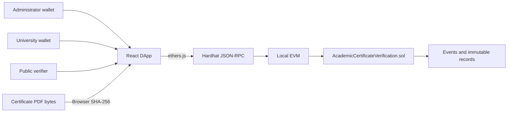

# Architecture

## Components

- **React** renders pages and form state.
- **ethers.js** encodes calls, signs wallet transactions, reads state, and waits for receipts.
- **MetaMask** supplies the active signer for writes. Public verification uses a read-only JSON-RPC provider and works without a wallet.
- **RPC** is the protocol endpoint at `127.0.0.1:8545`.
- **Hardhat** provides the local blockchain, deterministic accounts, compiler, tests, and receipts.
- **Solidity/EVM** execute and enforce the contract rules.
- **Browser-local SHA-256** hashes exact PDF bytes with Web Crypto when available and an ethers fallback on LAN HTTP; neither path uploads the file.
- **QR** encodes a frontend verification URL, not a validity claim.

## Issuance flow

1. Administrator registers a university wallet.
2. Solidity stores the university and emits `UniversityRegistered`.
3. That wallet registers a student under its institution.
4. The browser reads the finalized PDF bytes and computes SHA-256.
5. The wallet submits certificate ID, student key, program, dates, and digest.
6. Solidity checks authorization, student ownership, unique ID, and nonzero digest.
7. The record is stored and `CertificateIssued` is emitted.
8. The UI creates a QR route for the certificate ID.

## Verification flow

1. A verifier types an ID or opens a QR route.
2. The frontend normalizes the ID and computes its `keccak256` lookup key.
3. It reads the record and issuer directly from the contract.
4. If a PDF is selected, the browser computes its SHA-256 without uploading it.
5. Status precedence is: nonexistent -> `NOT_FOUND`; revoked -> `REVOKED`; mismatched file -> `TAMPERED`; otherwise -> `VALID`.

## Trust boundaries

The administrator decides which wallets represent universities. Universities remain responsible for the truth of student and degree data. Blockchain makes later modification evident and issuer actions auditable; it cannot inspect institutional source records. Hardhat and its accounts are local-only. A production deployment would need governance, key recovery, privacy analysis, public infrastructure, and independent audits.

## Deployment configuration

`blockchain/scripts/deploy.js` compiles/deploys and overwrites `frontend/src/contracts/deployment.json` with the current chain ID, address, block, transaction, gas, and ABI. This prevents a restarted local chain from silently leaving the frontend pointed at an old address.
